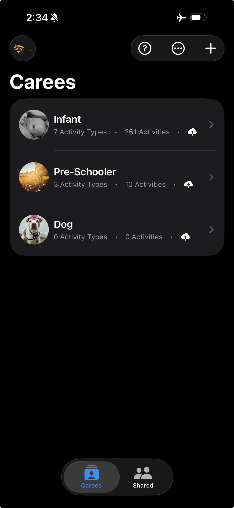
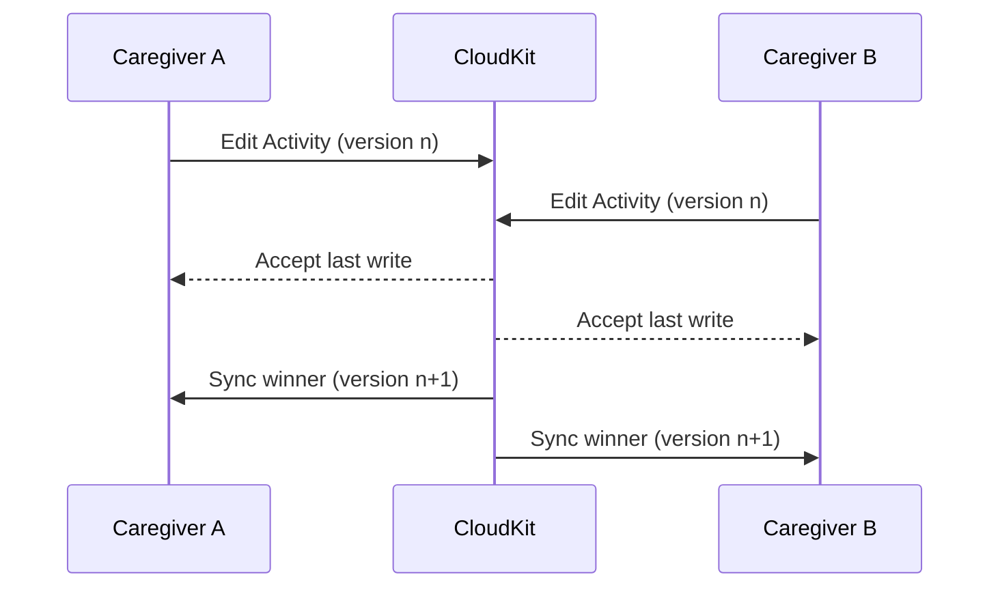
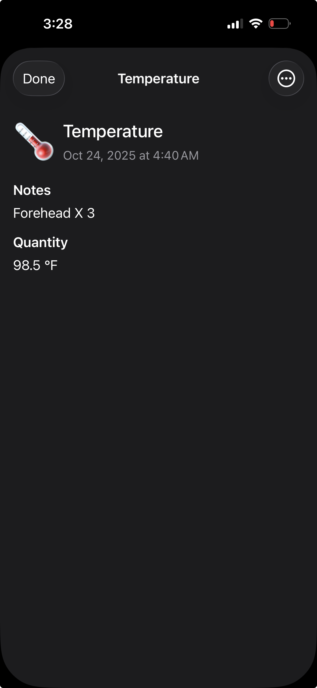
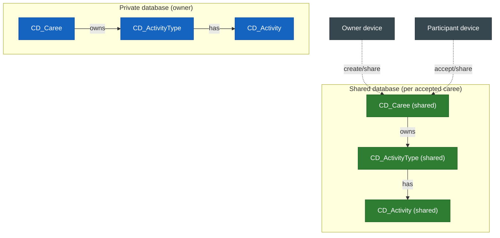

# Understanding Collaboration

CareKeeper's collaboration features enable multiple caregivers to coordinate care seamlessly. This page explains how sharing works, sync behavior, and best practices for collaborative care.

## How Collaboration Works

### The Basic Flow

1. **Owner creates a caree** with activity types
2. **Owner shares the caree** via share link
3. **Participants accept** the share invitation
4. **Everyone tracks activities** from their devices
5. **Data syncs automatically** via iCloud
6. **Notifications alert** about others' activities

### Real-Time Sync

When someone tracks an activity:

**Immediate** (your device):
- Activity appears instantly in your list
- UI updates optimistically
- No waiting for sync confirmation

**Seconds later** (other devices):
- CloudKit syncs in background
- Activity appears on all participants' devices
- Notifications sent (if enabled)
- Conflict resolution handles concurrent edits

!!! success "Resoonsive Feel"
    CareKeeper uses optimistic UI—your changes appear immediately while syncing happens in the background. This makes the app feel instant even with slow connections.

## Sharing Model

### Caree-Level Sharing

Sharing happens at the **caree level**, not account level:

✅ **Each caree can be shared independently:**
- Share your baby with your partner
- Share your dog with your roommates
- Keep your personal health tracking private
- Different participants for different carees

❌ **You cannot:**
- Share your entire CareKeeper account
- Share multiple carees at once (share each individually)
- Have different permissions for different carees

### Automatic Inclusion

When you share a caree, participants automatically get:
- 📋 All activity types for that caree
- 📊 All existing activities (full history)
- 🔄 All future activities tracked by anyone
- ➕ Ability to create new activity types and activities

### Owner vs Participant

**Owner** (person who created the caree):
- Created the caree originally
- Can delete the caree
- Can add/remove participants
- Can stop sharing entirely
- Full edit access to all data

**Participant** (invited caregiver):
- Accepted a share invitation
- Cannot delete the caree
- Cannot manage other participants
- Can leave the share voluntarily
- Full edit access to all data

!!! note "Equal Editing Rights"
    Except for caree deletion, all participants have equal rights. This enables true collaborative care without hierarchy.

## Sync Behavior

### When Sync Happens

CloudKit sync occurs:
- 🔄 **Immediately** when you track/edit an activity
- 🔄 **Every 15 seconds** in background (if app is active)
- 🔄 **On app launch** (pulls latest data)
- 🔄 **When pull-to-refresh** is used
- 🔄 **When push notification** arrives

### Offline Behavior

If your device is offline:

1. **Track normally** - Activities saved locally
2. **Queued for sync** - Marked as "pending"
3. **Synced when online** - Automatic retry
4. **Conflict resolution** - CloudKit handles concurrent edits

{: .doc-screenshot }

!!! tip "Offline Confidence"
    Don't worry about losing data offline. Everything is saved locally and will sync when you're back online.

### Conflict Resolution

If two people edit the same activity simultaneously:

**CloudKit's automatic resolution:**
1. **Detects conflict** (same record, different versions)
2. **Chooses "winner"** (typically last-write-wins)
3. **Syncs winner** to all devices
4. **No data loss** for most conflicts

**Rare edge cases:**
- If both people delete and edit simultaneously, deletion wins
- If sync fails repeatedly, manual intervention may be needed

!!! note "Rare Conflicts"
    Conflicts should be rare in practice because most activities are likely to be write-once (not edited) and edits happen on different activities.

## Notifications

### Activity Notifications

Get notified when other participants track activities:

**What you'll be notified about:**
- ✅ New activities tracked by others
- ✅ Activity types created by others
- ✅ Caree details updated by others

**What you won't be notified about:**
- ❌ Your own activities
- ❌ Carees where notifications are disabled
- ❌ Edits to existing activities (only new activities)

[SCREENSHOT: Example activity notification]

### Notification Settings

**Global toggle:**
- Settings > Notifications > Enable/disable all

**Per-caree toggle:**
- Caree detail view > Bell icon > Enable/disable for this caree

**iOS System Permissions:**
- Settings > CareKeeper > Notifications > Must be enabled

[SCREENSHOT: Notification settings]

### Notification Content

Notifications show:
- 📱 Caree name
- 🏷️ Activity type
- 📊 Quantity (if applicable)
- 👤 Who tracked it (if identifiable)
- ⏰ When it was tracked

Tap notification to:
- 🔍 View activity details
- ✏️ Edit if needed
- 📋 See recent activity list

[SCREENSHOT: Notification with tap action]

## Best Practices

### Communication

**Before sharing:**
- 💬 Discuss what to track
- 📋 Agree on activity type names
- 📏 Decide on units (oz vs ml, etc.)
- 🔔 Set notification preferences

**During collaboration:**
- 📝 Use notes to communicate
- 📊 Review activity history together

### Privacy Within Groups

Even with trusted participants:

**Be mindful:**
- 🔒 Notes are visible to all participants
- 📍 Locations are visible to all participants
- 📸 Profile photos are visible to all participants
- 📊 Full activity history is visible to all participants

**Guidelines:**
- Don't include sensitive information others shouldn't see
- Discuss privacy expectations upfront
- Update sharing if expectations change

## Advanced Topics

### Sync Architecture

CareKeeper uses CloudKit's private and shared databases:

**Private database:**
- Your owned carees
- Your activity types and activities for owned carees
- Synced across your devices only

**Shared database:**
- Carees others have shared with you
- Activity types and activities for shared carees
- Synced with all participants

### Performance Optimization

For large shared carees (hundreds of activities):

**iOS:**
- Loads all data (no limits)
- Uses SwiftData for efficient queries
- Background refresh keeps data current

**watchOS:**
- Loads only last 24 hours of activities
- Limits to 100 activities per caree
- Clears cache on view disappear
- Optimized for memory constraints

!!! note "watchOS Limitations"
    If you need full history on watch, view on iPhone instead. The 24-hour window is intentional for performance.

### Data Consistency

CareKeeper maintains consistency through:

1. **Optimistic UI** - Shows your changes immediately
2. **Background sync** - Uploads changes asynchronously
3. **Conflict resolution** - Handles simultaneous edits
4. **Retry logic** - Re-attempts failed syncs automatically
5. **Pull-to-refresh** - Manual sync trigger for users

This architecture provides both speed and reliability.

## Related Topics

- [How to Share a Caree](../how-to/share-caree.md)
- [Security & Privacy](security-privacy.md)
- [FAQ](../reference/faq.md)
