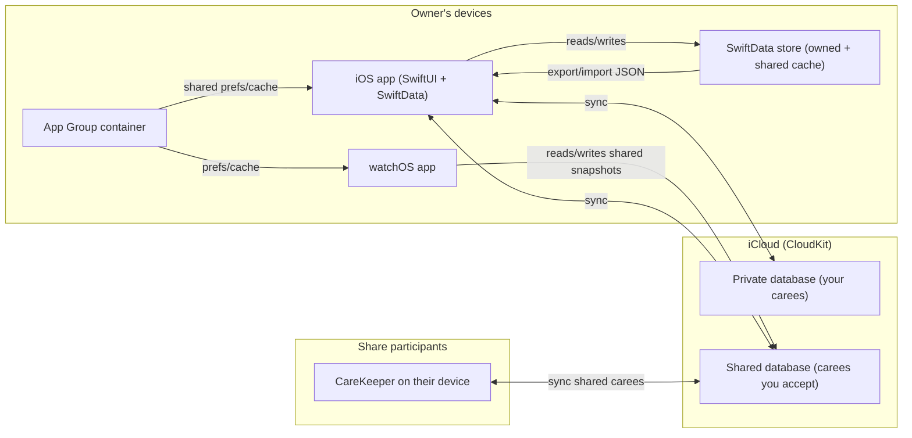
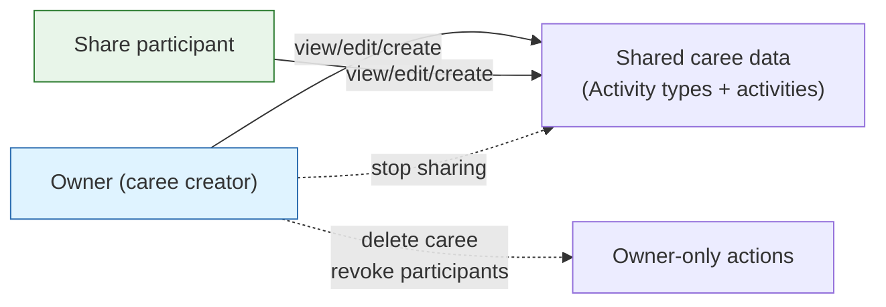

# Security & Privacy

CareKeeper takes your privacy seriously. This page explains how your data is protected, what security measures are in place, and what you should know about sharing.

## Data Storage

### Where Your Data Lives

Your CareKeeper data is stored in two places:

**On Your Device:**
- SwiftData database (Apple's modern Core Data)
- App group container (shared between iPhone and Watch)
- Encrypted when device is locked
- File Protection Complete enabled

**In iCloud:**
- CloudKit database (Apple's cloud service)
- Private database for your owned carees
- Shared database for carees others have shared with you
- Stored in Apple's data centers



### What Data Is Stored

CareKeeper stores:
- ✅ Caree information (names, photos)
- ✅ Activity types (names, icons, configuration)
- ✅ Activities (timestamps, quantities, locations, notes)
- ✅ Sharing metadata (participant lists for shared carees)
- ✅ App preferences (notification settings, etc.)

CareKeeper does NOT store:
- ❌ Your Apple ID password
- ❌ Your personal health data (unless you manually track it)
- ❌ Activity logs from other tracking apps
- ❌ Any data not explicitly entered in the app

## Encryption

### Encryption at Rest

**On Your Device:**
- All data encrypted using iOS File Protection Complete
- Encryption key tied to your device passcode
- Data inaccessible when device is locked
- Protected from physical device theft

**In iCloud:**
- All data encrypted on Apple's servers
- Infrastructure-level encryption (same as iCloud Notes, Reminders)
- Encryption keys managed by Apple
- Industry-standard AES-256 encryption

```mermaid
flowchart TD
    Local["On-device files (SwiftData, app group)"]
    FileProtection["iOS File Protection (Complete)"]
    Keychain["Device passcode-derived keys"]
    Transit["Data in transit"]
    TLS["TLS 1.3 to CloudKit"]
    Cloud["CloudKit storage (Apple data centers)"]
    InfraEnc["Infrastructure encryption at rest (AES-256, Apple-managed keys)"]

    Local --> FileProtection --> Keychain
    Local --> Transit
    Transit --> TLS --> Cloud --> InfraEnc
    note right of InfraEnc: Enables sharing (not end-to-end)
```

!!! info "Infrastructure Encryption"
    CareKeeper uses infrastructure-level encryption rather than end-to-end encryption. This is necessary for CloudKit sharing to work—participants need to be able to decrypt shared data.

### Encryption in Transit

All data transmission is encrypted:
- TLS 1.3 between your device and Apple's servers
- Certificate pinning for CloudKit connections
- Man-in-the-middle attack protection
- No data transmitted in plain text

### Why Not End-to-End Encryption?

**End-to-end encryption** (where only you have the decryption key) is **incompatible with CloudKit sharing**:

❌ **With E2E encryption:**
- Only you could decrypt your data
- Share participants would see encrypted gibberish
- Collaboration would be impossible

✅ **With infrastructure encryption:**
- Apple encrypts data at rest and in transit
- Share participants can decrypt shared data
- Collaboration works seamlessly

!!! note "Industry Standard"
    This is the same approach used by Apple's own collaborative apps: iCloud Notes, Reminders, shared photo albums, and collaborative documents.

## Authentication

### iCloud Account Required

CareKeeper requires you to be signed into iCloud:

**Why iCloud is required:**
- Sync between your devices
- Share with other caregivers
- Backup and recovery
- Identity verification

**How sign-in works:**
- No separate CareKeeper account to create
- Uses your existing Apple ID
- Two-factor authentication if enabled
- Managed through iOS Settings

[SCREENSHOT: iCloud sign-in requirement]

!!! tip "Two-Factor Authentication"
    Enable 2FA on your Apple ID for additional security: Settings > [Your Name] > Password & Security > Two-Factor Authentication.

### No Third-Party Authentication

CareKeeper does NOT support:
- ❌ Email/password accounts
- ❌ Social login (Google, Facebook)
- ❌ Guest access
- ❌ Anonymous usage

This is intentional—relying on Apple ID provides:
- ✅ Strong authentication
- ✅ Existing user trust
- ✅ No password management
- ✅ No data breaches (we don't store credentials)

## Sharing & Permissions

### Who Can Access Your Data

**Only you** have access to your data by default:
- Your owned carees
- Your activity types
- Your activities

**People you invite** can access:
- Specific carees you share
- Activity types for those carees
- Activities for those carees

**Apple** has technical access but:
- Cannot decrypt without legal warrant
- Subject to Apple's privacy policy
- Not used for advertising or profiling
- Protected by Apple's security practices



### Share Acceptance Required

No one can access your data without explicit invitation:

1. **You send a share link** via Messages, Mail, etc.
2. **Recipient receives link** and taps it
3. **Recipient must actively accept** the share
4. **You can see who has access** in participant list
5. **You can revoke access** at any time

!!! warning "Trust Your Participants"
    Anyone you share with has full read/write access to that caree's data. Only share with people you trust.

### Participant Permissions

All participants have equal access:
- ✅ View all activities and activity types
- ✅ Create new activities
- ✅ Edit existing activities
- ✅ Delete activities
- ✅ Create new activity types
- ✅ Edit activity types
- ✅ Edit caree details (name, photo)

Only the owner can:
- 🔒 Delete the caree entirely
- 🔒 Remove participants
- 🔒 Stop sharing

!!! note "No Granular Permissions"
    CareKeeper does not support read-only access or custom permission levels. All participants are trusted collaborators with equal editing rights.

## Privacy Best Practices

### What to Share

**Safe to share:**
- ✅ Carees for collaborative care (your child, shared pet)
- ✅ Activity types needed by all caregivers
- ✅ Activities relevant to ongoing care

**Think carefully before sharing:**
- 🤔 Carees with sensitive data
- 🤔 Activities with private notes
- 🤔 Carees you're tracking for yourself (personal habits, sleep patterns)

**Don't share:**
- ❌ Carees with people who don't need access
- ❌ Your entire account (share specific carees only)

### Photo Privacy

Profile photos are synced and visible to all participants:
- Choose appropriate photos for shared carees
- Consider if participants should see the photo
- Update or remove photos if sharing status changes

### Location Privacy

Location data is captured and synced:
- Only enable location tracking for activity types where it adds value
- Remember locations are visible to all participants
- Consider privacy implications (e.g., tracking walks might reveal home address)

!!! tip "Location Control"
    Disable location tracking for activity types used at home if you don't want to share your home coordinates.

### Notes Privacy

Notes are visible to all participants:
- Don't include sensitive information unless all participants should see it
- Review notes before saving
- Edit or delete notes if sharing status changes

## Data Access & Control

### Your Rights

You have complete control over your data:

**Access:**
- ✅ View all your data at any time
- ✅ Export data as JSON
- ✅ Download data for offline storage

**Modify:**
- ✅ Edit any caree, activity type, or activity
- ✅ Delete individual records
- ✅ Delete entire carees

**Share:**
- ✅ Share specific carees
- ✅ Revoke sharing at any time
- ✅ Control participant list

**Delete:**
- ✅ Delete your account by deleting all carees
- ✅ Remove all data from CareKeeper
- ✅ Data remains in your iCloud backups (managed separately)

### Data Retention

**Active usage:**
- Data retained indefinitely while you use CareKeeper
- Synced across all your devices
- Backed up to iCloud

**After deletion:**
- Deleting a caree removes it from all devices
- Removal from iCloud typically within 24 hours
- iCloud backups may retain data longer (managed by iOS)

**After uninstalling:**
- Data remains in iCloud (not automatically deleted)
- Data remains accessible if you reinstall
- To fully delete, remove carees before uninstalling

### Export Your Data

You always have access to your data:

1. Open Settings > Export Data
2. Choose carees to export
3. Receive JSON file with all data
4. Store locally, analyze, or migrate

See [How to Export Data](../how-to/export-data.md) for details.

## Compliance & Regulations

### GDPR (EU Data Protection)

CareKeeper respects GDPR rights:
- ✅ Right to access (export feature)
- ✅ Right to rectification (edit features)
- ✅ Right to erasure (delete features)
- ✅ Right to data portability (export as JSON)
- ✅ Transparent data practices (this document)

**Data controller:** You (the user)
**Data processor:** Apple (via iCloud)

### HIPAA (US Healthcare)

CareKeeper is **NOT** HIPAA compliant:
- ❌ No Business Associate Agreement with users
- ❌ No audit trails
- ❌ No access logs
- ❌ Infrastructure encryption only (not end-to-end)

!!! danger "Healthcare Use"
    Do not use CareKeeper for tracking Protected Health Information (PHI) subject to HIPAA. It is designed for personal care tracking, not regulated healthcare data.

### CCPA (California Privacy)

CareKeeper respects CCPA rights:
- ✅ No sale of personal information
- ✅ No sharing with third parties for marketing
- ✅ Right to access personal information
- ✅ Right to delete personal information

## Security Incidents

### Reporting

If you discover a security vulnerability:
- 📧 Email: [security contact info]
- 🐛 GitHub: Create a private security advisory (if open-source)
- ⏰ Expected response time: 48 hours

### Disclosure Policy

Security issues are handled responsibly:
1. Issue reported to maintainers
2. Investigation and fix development
3. Release of patched version
4. Public disclosure after users have time to update

## Third-Party Services

### What CareKeeper Uses

**Apple Services:**
- iCloud (CloudKit) for data storage and sync
- Push notifications (APNs) for activity alerts
- Sign in with Apple ID for authentication

**No other third-party services:**
- ❌ No analytics (Google Analytics, etc.)
- ❌ No crash reporting (Sentry, Crashlytics, etc.)
- ❌ No advertising networks
- ❌ No social media integrations
- ❌ No third-party databases

!!! success "Privacy-First"
    By minimizing third-party dependencies, CareKeeper reduces attack surface and data exposure.

## Recommendations

### Device Security

Secure your devices:
- 📱 Use strong passcode (6+ digits, Face ID, Touch ID)
- 🔒 Enable automatic lock (Settings > Display & Brightness > Auto-Lock)
- 🛡️ Keep iOS updated (Settings > General > Software Update)
- 🔐 Enable Find My (Settings > [Your Name] > Find My)

### iCloud Security

Secure your iCloud account:
- 🔑 Use strong, unique Apple ID password
- 2️⃣ Enable Two-Factor Authentication
- 📧 Monitor account activity
- 🚨 Review trusted devices regularly

### Sharing Security

Share responsibly:
- 👥 Only invite trusted caregivers
- 🔍 Review participant lists periodically
- 🚫 Remove participants who no longer need access
- 💬 Communicate with participants about privacy expectations

## Questions?

Common privacy questions:

**Q: Can Apple see my notes?**
A: Technically yes, but only with a legal warrant. Apple doesn't access user data for advertising or profiling.

**Q: What happens if I lose my device?**
A: Use Find My to remotely wipe your device. Your data remains safe in iCloud and can be restored to a new device.

**Q: Can share participants see my other carees?**
A: No. Sharing is per-caree. Participants only see the specific caree(s) you've shared with them.

**Q: How do I completely delete all my data?**
A: Delete all carees in CareKeeper, then uninstall the app. iCloud backups may retain data—manage backups in Settings > [Your Name] > iCloud > Manage Storage > Backups.

For more questions, see the [FAQ](../reference/faq.md).

## Related Topics

- [Understanding Collaboration](collaboration.md)
- [How to Share a Caree](../how-to/share-caree.md)
- [How to Export Data](../how-to/export-data.md)
