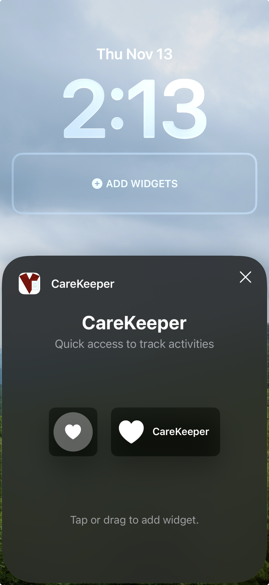
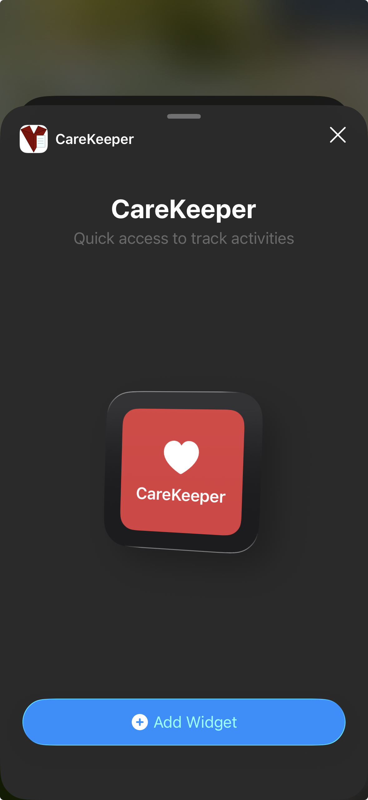

# Add CareKeeper to Your Lock Screen

Launch CareKeeper in a tap from your lock screen with the iOS Lock Screen launcher widget.

## Add the Lock Screen Widget

1. Press and hold your Lock Screen, then tap **Customize**
2. Choose **Lock Screen**
3. Tap the widget area beneath the clock
4. Scroll to **CareKeeper** in the list and tap it
5. Pick the **Launch CareKeeper** widget
6. Tap **Done** to save

{: .doc-screenshot }

## Add a Home Screen Launcher (optional)

1. Press and hold the Home Screen until icons jiggle
2. Tap **Edit** in the top-left
3. Tap **Add Widget**
4. Search for **CareKeeper**
5. Choose the **Launch CareKeeper** widget
6. Pick a size and tap **Add Widget**
7. Drag it to your preferred spot and tap **Done**

{: .doc-screenshot }
