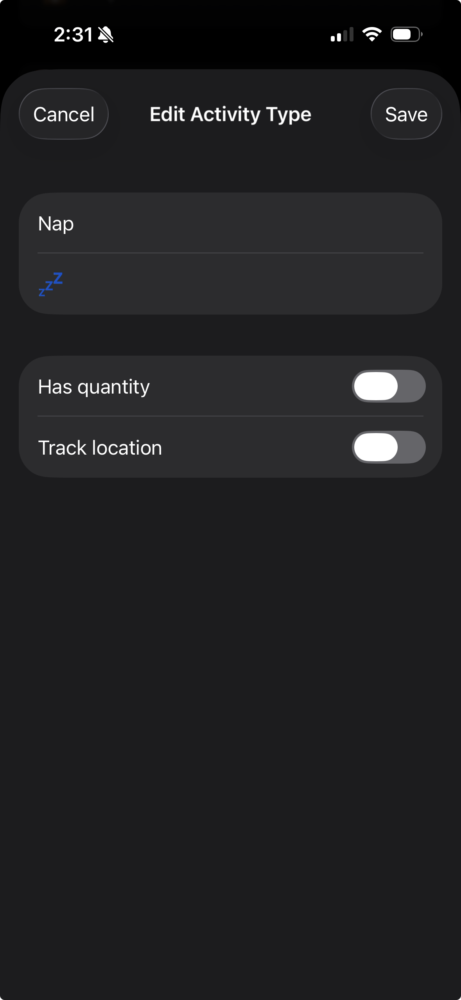
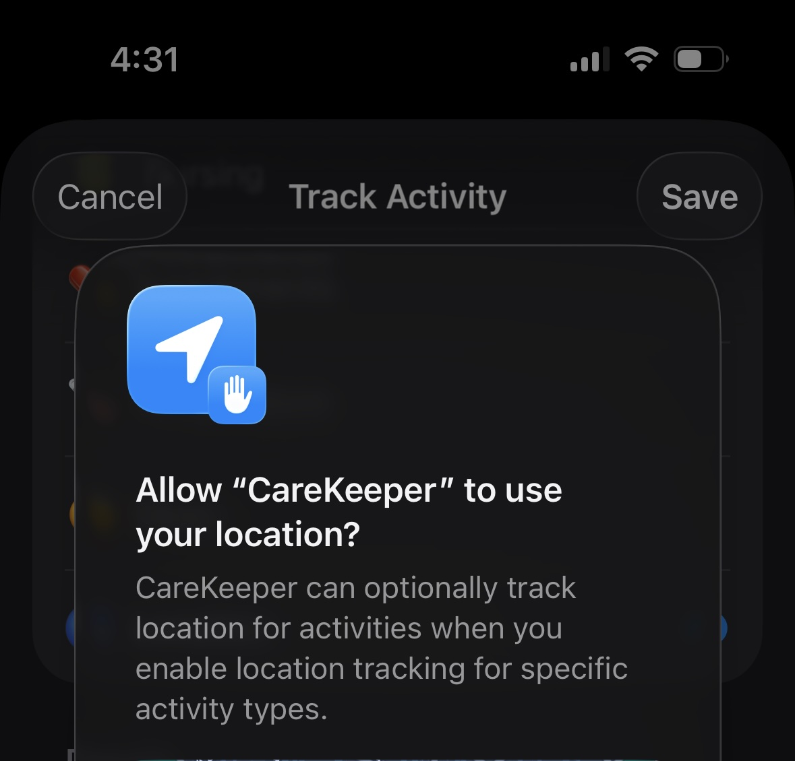
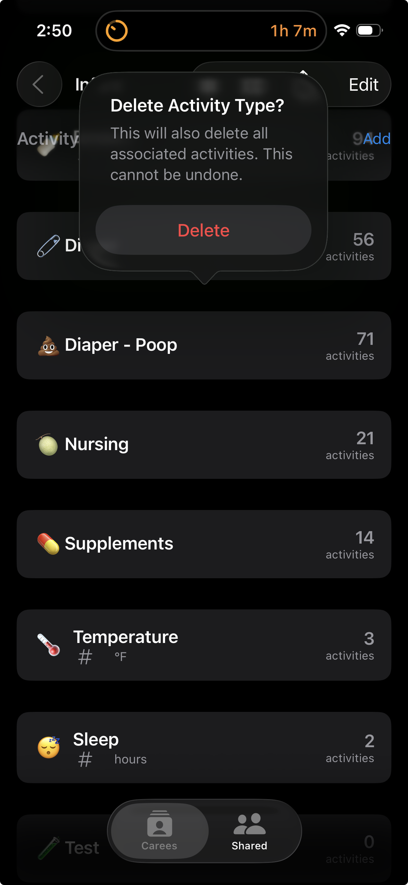
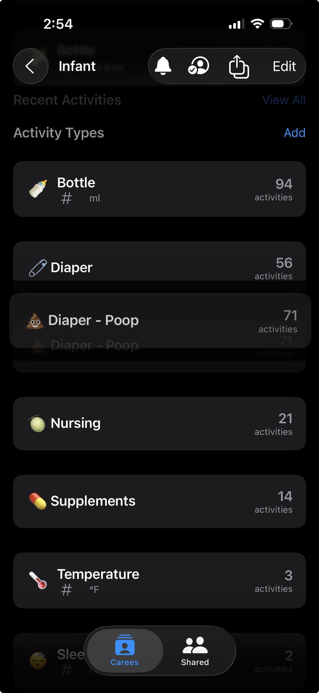

# How to Create an Activity Type

Activity types are the building blocks of tracking in CareKeeper. This guide covers all options for creating and customizing activity types.

## Quick Steps

1. Open your caree's detail view
2. Tap **+ Add Activity Type**
3. Configure name, icon, and tracking options
4. Tap **Save**

## Detailed Instructions

### Open Activity Type Creation

1. Open CareKeeper and tap on a caree
2. In the "Activity Types" section, tap **+ Add Activity Type**
3. You'll see the activity type form

### Choose a Name

1. Tap the **Name** field
2. Enter a clear, descriptive name (e.g., "Feeding", "Walk", "Playtime")
3. Keep it short for better display on watch

!!! tip "Naming Best Practices"
    - Keep under 20 characters for watch compatibility

### Select an Icon

Icons help you quickly identify activity types. You can use:

#### Emojis
1. Tap the **Icon** field
2. Your emoji keyboard appears
3. Select any emoji (🍼, 😴, 🚶, etc.)

[SCREENSHOT: Emoji picker]

#### SF Symbols
1. Tap the **Icon** field
2. Type an SF Symbol name (e.g., "drop.fill", "figure.walk")

[SCREENSHOT: SF Symbol selection]

!!! note "SF Symbols"
    SF Symbols are Apple's icon library. Search for symbols at [sf-symbols.com](https://developer.apple.com/sf-symbols/) or use common names like:
    - Activity: `figure.walk`, `figure.run`, `sportscourt.fill`
    - Food: `fork.knife`, `cup.and.saucer.fill`, `drop.fill`
    - Sleep: `bed.double.fill`, `moon.fill`
    - General: `checkmark.circle.fill`, `star.fill`

### Configure Quantity Tracking

Enable this if you want to record amounts (e.g., ounces, milliliters, minutes):

1. Toggle **Has Quantity** to **ON**
2. Enter a **Unit** (e.g., "oz", "ml", "min", "cups")
3. This unit will appear when tracking activities

[SCREENSHOT: Quantity configuration]

#### Examples of Quantity Use

| Activity Type | Quantity | Unit |
|--------------|----------|------|
| Bottle feeding | 3.5 | oz |
| Nursing | 15 | min |
| Walk | 30 | min |
| Water | 8 | oz |
| Sleep | 120 | min |

!!! tip "Decimal Values"
    Quantities support decimals, so you can track "3.5 oz" or "1.5 hours" precisely.

### Configure Location Tracking

Enable this to record where activities occurred:

1. Toggle **Has Location** to **ON**
2. CareKeeper will request location permission if not granted
3. When tracking, your current location is automatically captured

!!! note "Single point locations"
   - Locations are stored as a single point rather than a route/trail

!!! warning "Privacy Note"
    Locations are synced via iCloud and visible to anyone you share the caree with. Only enable for activity types where location adds value.

### Save Your Activity Type

1. Review your configuration
2. Tap **Save** in the top-right corner
3. The activity type appears in your list

[SCREENSHOT: Saved activity type in list]

### Editing Activity Types

To modify an existing activity type:

1. Open the caree detail view
2. Find the activity type in the list
3. Swipe left and tap **Edit**
4. Make your changes
5. Tap **Save**

[SCREENSHOT: Swipe to edit activity type]

!!! note "Editing Limitations"
    Changing an activity type affects how new activities are tracked, but doesn't modify existing activities.

### Deleting Activity Types

!!! danger "Permanent Deletion"
    Deleting an activity type also deletes all activities of that type. This cannot be undone.

1. Swipe left on the activity type
2. Tap **Delete**
3. Confirm the deletion

### Reordering Activity Types

Set the order for easier access:

1. Tap **Edit** in the Activity Types section
2. Drag the ☰ handle to reorder
3. Tap **Done**

!!! tip "Optimize for Watch"
    Put frequently-used types at the top. The watch app shows them in the same order.

## Examples

### Example 1: Bottle Feeding

**Scenario**: Track bottle feeding with volume

- **Name**: "Bottle"
- **Icon**: 🍼 or "drop.fill"
- **Has Quantity**: ON
- **Unit**: "oz"
- **Has Location**: OFF

[SCREENSHOT: Bottle feeding activity type configuration]

### Example 2: Dog Walking

**Scenario**: Track walks with duration and location

- **Name**: "Walk"
- **Icon**: 🚶 or "figure.walk"
- **Has Quantity**: ON
- **Unit**: "min"
- **Has Location**: ON

[SCREENSHOT: Walk activity type configuration]

### Example 3: Simple Diaper Change

**Scenario**: Quick tracking without extra data

- **Name**: "Diaper Change"
- **Icon**: 🚼 or "figure.and.child.holdinghands"
- **Has Quantity**: OFF
- **Has Location**: OFF

[SCREENSHOT: Simple activity type configuration]

## Troubleshooting

### Icon Not Showing
- If using SF Symbol, verify the name is correct
- Try using an emoji instead for simplicity
- Leave blank to use default icon
## Related Guides

- [How to Track an Activity](track-activity.md)
- [How to Use the Watch App](use-watch-app.md)
