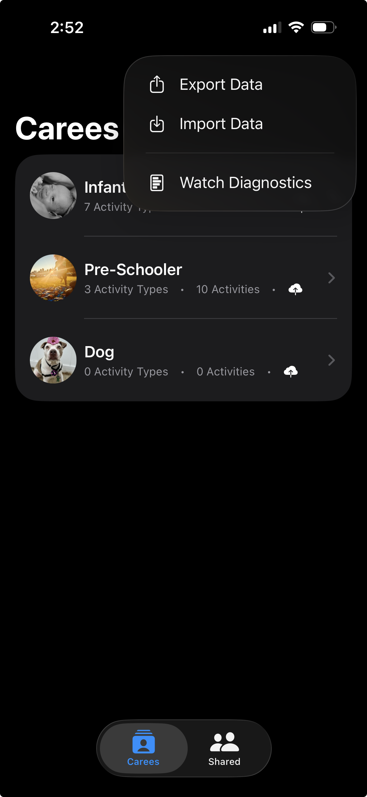
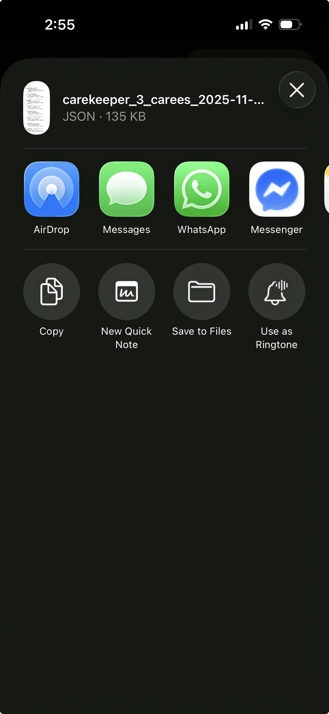

# How to Export Your Data

Export your CareKeeper data to JSON format for backup, analysis, or migration to other systems. This guide covers the export process and what you can do with your data.

## Quick Steps

1. Open CareKeeper on iPhone
2. Tap Settings (gear icon)
3. Scroll to "Data Management"
4. Tap **Export Data**
5. Choose a caree or export all
6. Save or share the JSON file

## Why Export Data?

### Backup
- Create a local backup of your tracking data
- Protect against data loss
- Archive old data before deleting

### Privacy
- Keep a copy of your data outside of iCloud
- Delete from CareKeeper while keeping records
- Control your own data

### Analysis
- Import into spreadsheets (Excel, Numbers, Google Sheets)
- Create custom charts and reports
- Analyze patterns over time


## Exporting Data

### Step 1: Open Export Settings

1. Open CareKeeper on your iPhone
2. Tap the kebab icon ("..."") in the top-right
3. Tap **Export Data**

{: .doc-screenshot }

### Step 2: Choose What to Export

You have two options:

#### Export All Data
- Includes all carees
- All activity types for each caree
- All activities across all carees
- Largest file size
- Most comprehensive backup

{: .doc-screenshot }

#### Export Single Caree
- Navigate to the caree's detail change and tap the export icon
- Includes only that caree's activity types and activities
- Smaller file size
- Useful for sharing with specific caregivers or providers

### Step 3: Export Process

1. Tap your choice (All Data or specific caree)
2. CareKeeper prepares the export (may take a few seconds for large datasets)
3. The iOS share sheet appears
4. Choose where to save or how to share

### Step 4: Save or Share

Choose from these options:

#### Save to Files
1. Tap **Save to Files**
2. Choose a location (iCloud Drive, On My iPhone, etc.)
3. Tap **Save**

#### Other Options
- Save to cloud services (Dropbox, Google Drive, OneDrive)
- Share to messaging apps
- Copy to Notes app


## Understanding the Export Format

### JSON Structure

CareKeeper exports data as JSON (JavaScript Object Notation)—a standard, human-readable format:

```json
{
  "carees": [
    {
      "activities": [
        {
          "activityTypeID": "2850FEE9-45CE-4E7C-9FF4-A12446EA7FCA",
          "dateCreated": "2025-11-11T18:56:14Z",
          "dateTime": "2025-11-11T18:56:14Z",
          "id": "82C581B5-6652-497B-9F12-38835E247DB9"
        }
      ],
      "activityTypes": [
        {
          "dateCreated": "2025-10-28T03:43:45Z",
          "hasLocation": false,
          "hasQuantity": false,
          "icon": "💩",
          "id": "2850FEF9-45CF-4E7C-9FF4-A12446EA7FCA",
          "listOrder": 2,
          "name": "Diaper - Poop"
        }
      ],
      "dateCreated": "2025-10-28T03:46:17Z",
      "id": "ACA13710-4B2D-4315-94DF-C3D649F0D739",
      "imageData": "\/9j\/4AAQSkZJRgABAQAASABIAAD\/...",
      "listOrder": 2,
      "name": "Newborn"
    }
  ],
  "exportDate": "2025-11-11T23:23:10Z",
  "version": "2.0"
}
```

### What's Included

**Caree Data:**
- ID (unique identifier)
- Name
- Date created
- Profile photo (base64 encoded if present)

**Activity Type Data:**
- ID (unique identifier)
- Name
- Icon (emoji or SF Symbol name)
- Quantity settings (hasQuantity, quantityUnit)
- Location settings (hasLocation)
- List order
- Date created

**Activity Data:**
- ID (unique identifier)
- Activity type reference
- Date and time
- Quantity (if applicable)
- Location coordinates (if applicable)
- Notes (if present)
- Date created

### What's NOT Included

The following are not included in exports:
- CloudKit sharing metadata (participant lists, share IDs)
- Sync status information
- User notification preferences
- Other users' carees (only your own)

## Using Exported Data

### Import into Spreadsheet

To analyze in Excel, Numbers, or Google Sheets:

1. Use a JSON-to-CSV converter tool:
   - Online: [ConvertCSV.com](https://www.convertcsv.com/json-to-csv.htm)
   - Desktop: jq command-line tool
   - Python: pandas library
2. Convert JSON to CSV format
3. Open CSV in your spreadsheet app

### Import into Another App

If migrating to another tracking app:

1. Check if the other app supports JSON imports
2. Map CareKeeper fields to their fields:
   - caree.name → their subject/person field
   - activityType.name → their category/type field
   - activity.dateTime → their timestamp field
3. Use their import tool or API

### Create Custom Reports

With programming knowledge, you can:

**Python Example:**
```python
import json
import pandas as pd

# Load export
with open('carekeeper_export.json') as f:
    data = json.load(f)

# Extract activities
activities = []
for caree in data['carees']:
    for activity in caree['activities']:
        if "quantity" not in activity:
            continue
        
        activities.append({
            'caree': caree['name'],
            'type': next(at['name'] for at in caree['activityTypes'] if at['id'] == activity['activityTypeID']),
            'dateTime': activity['dateTime'],
            'quantity': activity.get('quantity'),
            'notes': activity.get('notes')
        })

# Create DataFrame
df = pd.DataFrame(activities)

# Analyze
print(df.groupby('type')['quantity'].mean())
```

### Archive Old Data

For long-term archival:

1. Export all data
2. Save to multiple locations:
   - External hard drive
   - Cloud storage (Google Drive, iCloud)
   - USB drive
3. Include a README explaining the data structure
4. Store in a folder with date: `CareKeeper_Backup_2024-10-27`

!!! tip "Best Practice"
    Export and backup your data monthly, especially if you're tracking critical medical information.

## Importing Data (Re-Import)

### Import Backup into CareKeeper

To restore a previous export:

1. From the Carees page, open the kebab menu (the "..."s button)
2. Tap **Import Data**
3. Choose the JSON file
4. CareKeeper restores:
   - Carees
   - Activity types
   - Activities


## Privacy & Security

### Data Privacy
- Exported files contain all your tracking data
- Share carefully—only with trusted parties
- Consider removing sensitive notes before sharing
- Delete exported files from shared locations when no longer needed

### Encryption
- JSON exports are **not encrypted** by default
- If sharing via email/cloud, consider encrypting the file
- iOS Files app supports encryption via zip with password


## Related Guides

- [Understanding Security & Privacy](../explanation/security-privacy.md)
- [FAQ](../reference/faq.md)
