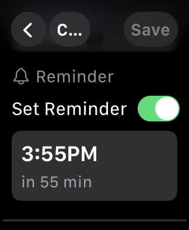

# How to Schedule Reminders

CareKeeper lets you attach personal reminders to specific activities so you get a nudge when it’s time to follow up. Reminders are local to each device (they don’t sync through iCloud), so you can tailor them per caregiver and per device.

## iPhone/iPad

1. Open a caree and tap an activity type.
2. Toggle **Set Reminder**.
3. Pick a future date/time (up to 7 days out).
4. Save the activity. You’ll see a bell icon next to any activity that has a pending reminder.

> If you haven’t granted Reminders access before, iOS will request permission when you toggle **Set Reminder**. If you dismiss the prompt or previously denied access, you’ll see an error with an **Open Settings** shortcut—enable Reminders access there, then retry.

## Apple Watch

1. Open the Track Activity view.
2. Toggle **Set Reminder**.
3. Use the Digital Crown to choose the number of minutes in the future (up to 24 hours).
4. Save the activity. The list and detail screens show a bell with either `📱` or `⌚️` depending on which device scheduled the reminder.

> watchOS now uses the same Reminders permission as iOS. If the toggle shows an error, tap **Open Settings** and grant Reminders access (Settings → Privacy & Security → Reminders, or via the Watch app) before retrying.

## Managing Existing Reminders

- Edit the activity from either device—updates propagate via the shared reminder metadata and EventKit’s iCloud sync.
- Turning off the toggle prompts you to confirm; accepting deletes the pending reminder across your devices.
- Deleting the activity also deletes its reminder.

## Screenshots

  
  

<!-- {: .doc-screenshot } -->
<!-- {: .doc-screenshot } -->
