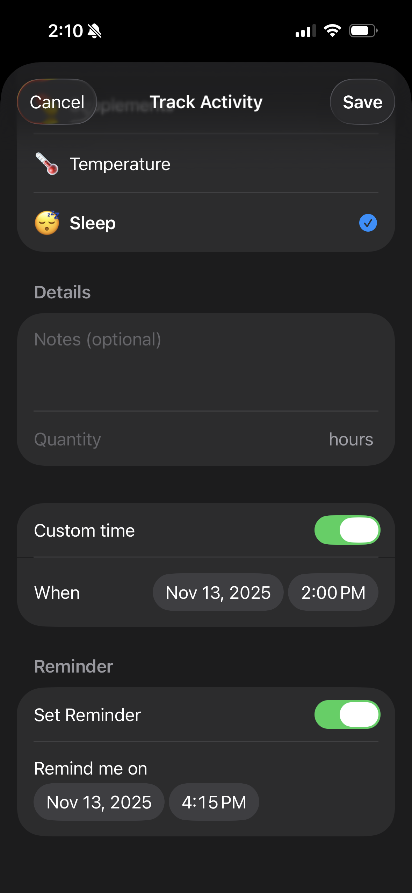

# How to Schedule Reminders

CareKeeper lets you attach personal reminders to specific activities so you get a nudge when it’s time to follow up.

- **iPhone/iPad** – We create a real Reminders.app entry. Because it lives in iCloud, it syncs to every device signed into the same Apple ID (including Apple Watch). You can open the Reminders app at any time to see/edit it like any other reminder.
- **Apple Watch** – watchOS does not expose EventKit reminder APIs to third-party apps, so CareKeeper creates a device-local notification instead of a Reminders.app entry. That notification fires only on that watch. This limitation comes directly from Apple’s watchOS SDK

## iPhone/iPad

1. Open a caree and tap an activity type.
2. Toggle **Set Reminder**.
3. Pick a future date/time (up to 7 days out). 
   1. When editing an existing activity, CareKeeper will not create or recreate a reminder for a past time—it will show an inline note explaining that only future times cause reminders to be scheduled.
4. Save the activity. You’ll see a bell icon next to any activity that has a pending reminder. Behind the scenes, a Reminders.app entry is added/updated and synced across all of your devices (including Apple Watch).

> If you haven’t granted Reminders access before, iOS will request permission when you toggle **Set Reminder**. If you dismiss the prompt or previously denied access, you’ll see an error with an **Open Settings** shortcut—enable Reminders access there, then retry.

## Apple Watch

1. Open the Track Activity view.
2. Toggle **Set Reminder**.
3. Use the Digital Crown to choose the number of minutes in the future (up to 24 hours).
4. Save the activity. The list and detail screens show a bell with either `📱` or `⌚️` indicating the device you used most recently. Because the watch can only schedule its own notification, any reminder created on watch stays local to that device until you edit it on iPhone/iPad.

> watchOS relies on Notification permission. If the toggle shows an error, open the Settings app on your watch (or the Watch app on iPhone) and enable **Notifications → CareKeeper → Allow Notifications** before retrying.

## Managing Existing Reminders

- Edit on **iPhone/iPad** to manage a Reminders.app entry that syncs everywhere (including Apple Watch). If the reminder originally came from Apple Watch, saving your edits on iPhone “upgrades” it into an iCloud reminder; the original watch notification may still fire at its original time, so you might see one extra alert during the transition.
- Edit on **Apple Watch** to adjust or delete that device’s local notification. Those changes do **not** mutate the iCloud reminder until you edit the activity on iPhone.
- Toggling the reminder off on iPhone removes the Reminders.app entry and clears the matching watch notification. Toggling it off on watch removes the watch notification only.
- Deleting the activity removes associated reminders/notifications on your devices.

## Screenshots

  
  
  
  

<!-- {: .doc-screenshot } -->
<!-- {: .doc-screenshot } -->
