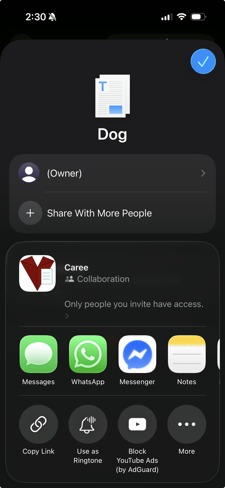
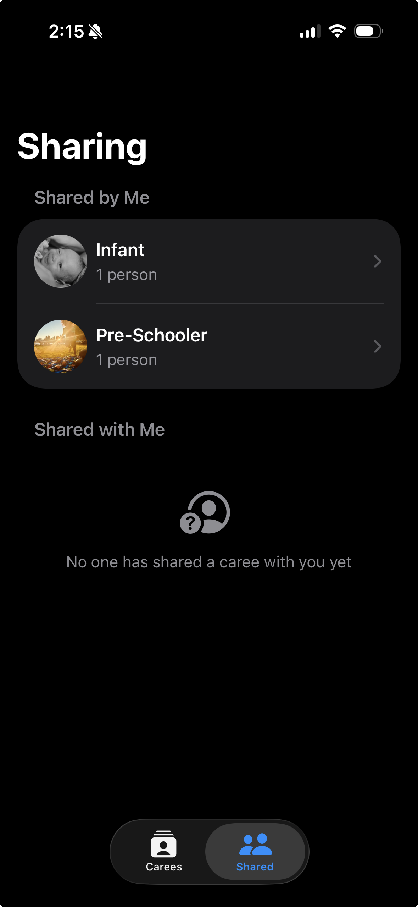
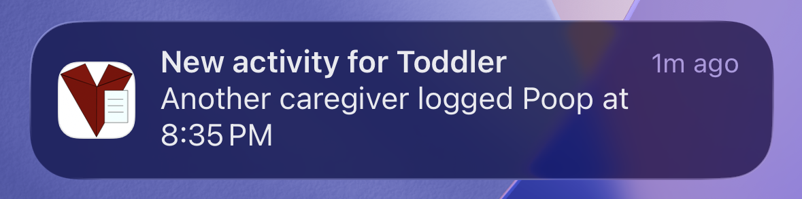

# How to Share a Caree

Share a caree with other caregivers to enable collaborative care tracking. All participants can track activities, create activity types, and see real-time updates.

## Quick Steps

1. Open your caree's detail view
2. Tap the **Share** button (square with up arrow)
3. Choose how to send the invitation
4. Recipient accepts the share
5. Start collaborating!

## Before You Start

### Requirements
- **Owner**: Must be signed into iCloud
- **Participants**: Must be signed into iCloud
- **Both**: Must have CareKeeper installed

### What Gets Shared
When you share a caree, participants can access:
- ✅ Caree details (name, photo)
- ✅ All activity types
- ✅ All activities (past and future)
- ✅ Ability to create/edit/delete activities
- ✅ Ability to create/edit activity types

### What Doesn't Get Shared
- ❌ Your other carees (sharing is per-caree)
- ❌ Your personal settings
- ❌ Ability to delete the caree (owner only)

## Sharing a Caree

### Step 1: Open Share Options

1. Open CareKeeper and tap on your caree
2. Tap the **Share** button in the top-right corner (square with up arrow)
3. The iOS share sheet appears

[SCREENSHOT: Share button location in caree detail view]

### Step 2: Choose Share Method

You can share via:

#### Messages
1. Tap the **Messages** icon
2. Select a contact or enter a phone number
3. Tap **Send**

{: .doc-screenshot }

#### Copy Link
1. Tap **Copy Link**
2. Paste the link in any app (WhatsApp, Slack, etc.)

!!! tip "Multiple Participants"
    You can share with multiple people—just send the share link to each person individually.

### Step 3: Confirmation

After sending:
- The share is active immediately
- Participants can accept at their convenience

## Accepting a Share

### As a Recipient

When you receive a share invitation:

1. Tap the share link in Messages, Mail, or other app
2. CareKeeper opens automatically
3. Tap **Accept** to join

[SCREENSHOT: Share acceptance screen]

!!! success "Instant Access"
    Once you accept, all activity types and history for the caree are fetched and cached for offline access. This may take a moment.

## Managing Participants

### Viewing Participants

To see who has access to a caree:

1. Open the caree detail view
2. Tap the **Share** button
3. Scroll down to see "People" section
4. All participants are listed with their names and icons

{: .doc-screenshot }

### Removing a Participant

As the owner, you can remove participants:

1. Open the share sheet
2. Tap the participant's name
3. Tap **Remove Access**
4. Confirm removal

!!! warning "Immediate Effect"
    Removing a participant takes effect immediately. They lose access to the caree, activity types, and activities.

### Leaving a Shared Caree

As a participant (non-owner), you can leave:

1. Open the caree detail view
1. Open the share sheet
3. Scroll down and tap **Stop Sharing**
4. Confirm

## Understanding Permissions

### Owner Permissions
As the person who created and shared the caree, you can:
- ✅ Create, edit, delete activities
- ✅ Create, edit, delete activity types
- ✅ Edit caree details (name, photo)
- ✅ Delete the caree
- ✅ Add or remove participants
- ✅ Stop sharing entirely

### Participant Permissions
As someone who accepted a shared caree, you can:
- ✅ Create, edit, delete activities
- ✅ Create, edit, delete activity types
- ✅ Edit caree details (name, photo)
- ❌ **Cannot** delete the caree (owner only)
- ❌ **Cannot** manage other participants

!!! note "Equal Tracking Rights"
    All participants have the same ability to track and manage activities. This enables true collaborative care without restrictions.

## Notifications

Stay informed about activities logged by other caregivers:

### Enabling Notifications

1. Open Settings (gear icon)
2. Tap **Notifications**
3. Grant notification permission if prompted
4. Enable notifications per caree

[SCREENSHOT: Notification settings]

### What You'll Be Notified About

You'll receive notifications when:
- Another caregiver tracks an activity
- Someone creates a new activity type
- Caree details are updated

You won't be notified about:
- Your own activities
- Carees you haven't enabled notifications for

### Managing Notification Settings

**Per-Caree Control**:
1. Open caree detail view
2. Tap the bell icon
3. Toggle notifications on or off

[SCREENSHOT: Per-caree notification toggle]

**Global Settings**:
- Turn off all notifications in iOS Settings > CareKeeper > Notifications

## Best Practices

### Communication Tips
- 📋 Agree on activity type names and units
- 👥 Share only with trusted caregivers

### Privacy Tips
- 🔒 Only share with people who need access
- 👤 Use caree photos that all participants are comfortable with
- 📍 Discuss location tracking preferences
- 🚫 Remove participants who no longer need access

## Related Guides

- [Understanding Collaboration](../explanation/collaboration.md)
- [Security & Privacy](../explanation/security-privacy.md)
