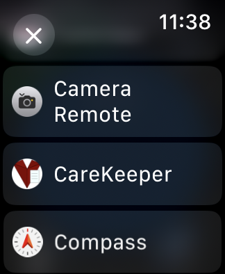
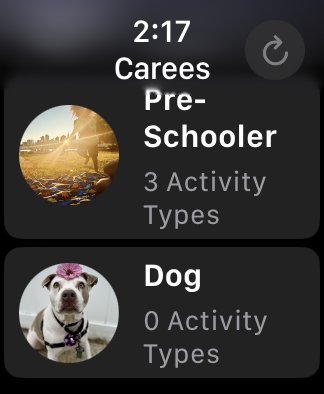
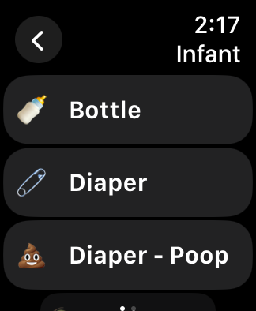
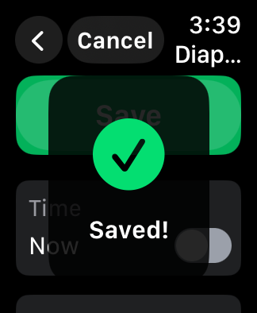
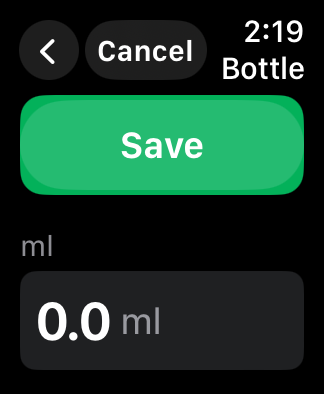
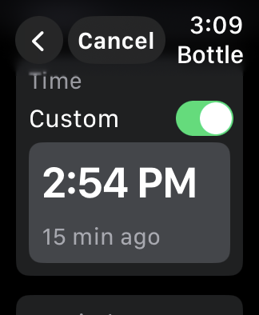
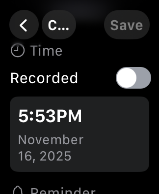
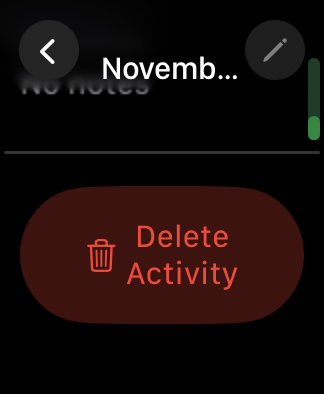
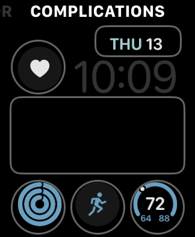

# How to Use the Watch App

The CareKeeper watchOS app is designed for speed—track activities in seconds without pulling out your phone. This guide covers everything you need to know about the watch app.

## Quick Reference

- **One-tap tracking**: Tap activity type → Done (no quantity)
- **Quantity tracking**: Tap activity type → Adjust with Digital Crown → Save
- **View activities**: Swipe down on caree detail → Activities
- **Edit activity**: Tap activity → Edit → Adjust → Save

## Getting Started

### Installation

CareKeeper installs automatically on your Apple Watch when you install it on your iPhone. If it doesn't appear:

1. Open the Watch app on your iPhone
2. Scroll to find CareKeeper
3. Tap **Install**

{: .doc-screenshot }

### First Launch

1. Raise your wrist or press the Digital Crown
2. Find and tap the CareKeeper icon
3. Wait a few seconds for initial sync
4. Your carees appear automatically

[SCREENSHOT: First launch sync screen]

!!! note "Initial Sync"
    The first launch may take a few seconds to a few minutes (if you have a lot of data owned or shared) to sync carees and activity types from your iPhone. Subsequent launches should be instant.

## Navigating the Watch App

### Main Screen: Caree List

When you open CareKeeper, you see your caree list:

- Each caree shows name and photo (if set)
- Scroll with Digital Crown or swipe
- Tap a caree to see activity types

{: .doc-screenshot }

### Caree Detail: Activity Type Buttons

After tapping a caree:

- Large buttons for each activity type
- Icon and name clearly visible
- Scroll to see more activity types
- Tap to track

{: .doc-screenshot }

!!! tip "Button Order"
    Activity types appear in the same order as your iPhone. Put frequent ones at the top for quick access.

## Tracking Activities

### Simple One-Tap Tracking

For activities without quantity (diaper changes, naps, etc.):

1. Tap your caree
2. Tap the activity type button
3. Tap **Save**
4. ✓ Confirmation checkmark appears
5. Done! Activity tracked.

### Tracking with Quantity

For activities with quantity (feeding, water, etc.):

1. Tap your caree
2. Tap the activity type button
3. Quantity adjustment screen appears
4. **Use Digital Crown** to adjust:
   - Turn clockwise: increase
   - Turn counterclockwise: decrease
   - Spin faster for bigger jumps
5. Tap **Save**

!!! tip "Digital Crown Mastery"
    - **Slow turn**: Adjust by 0.5 units (e.g., 3.0 → 3.5 → 4.0)
    - **Fast spin**: Jump by 1-5 units
    - **Press**: Same as tapping Save

### Custom Time

By default, activities are tracked at "Now". To change the time:

1. On the quantity screen, swipe down or scroll
2. Toggle **Custom Time** to ON
3. Scroll or use Digital Crown to adjust time
4. Tap **Save**

{: .doc-screenshot }

## Viewing Activities

### Recent Activities

From the caree detail screen:

1. Swipe left on the activity types list to see the Activities button
2. Tap **Activities**
3.  Past 24 hours of activities appear in reverse chronological order

### Activity Details

Tap any activity to see:
- Activity type icon and name
- Date and time
- Quantity (if applicable)
- Notes (if added on iPhone)
- Location (if applicable)

[SCREENSHOT: Watch activity detail view]

### Filtering Activities

To filter by activity type:

1. On the activity list screen
2. Tap the filter icon (top-left)
3. Tap through to cycle filters:
   - All Activities
   - Specific activity type
   - Next activity type
   - Etc.

  
  

!!! tip "Quick Filter"
    Each tap cycles to the next activity type. Much faster than a picker on the small watch screen.

## Editing Activities

### Edit Quantity or Time

1. Open activity list
2. Tap the activity
3. Tap **Edit**
4. Use Digital Crown to adjust quantity or time
5. Tap **Save**

<!--  -->

  
  
  

### Delete Activity

1. Open activity list
2. Tap the activity
3. Scroll down
4. Tap **Delete Activity**
5. Confirm deletion

{: .doc-screenshot }

## Watch Complications

Add CareKeeper to your watch face for instant access:

### Adding a Complication to Your Watch Face (Quick Launch)

1. Press and hold your watch face
2. Tap **Edit**
3. Swipe to the complications screen
4. Tap a complication slot
5. Scroll to find **CareKeeper**
6. Tap it to add
7. Press Digital Crown to save

{: .doc-screenshot }

Using the Complication: tap the complication from any face to jump straight to your last-used caree list

### Carees Not Appearing
**Solutions:**
- Open the iPhone app to trigger sync
- Check internet connection on both devices
- Wait 10-15 seconds on first launch
- Force quit and reopen watch app

### Activities Not Syncing
**Solutions:**
- Make sure Apple Watch is connected to iPhone
- Check sync status on iPhone app
- Pull down to refresh on iPhone
- Wait a few seconds for iCloud sync
## Advanced Features

### Haptic Feedback

CareKeeper uses haptic feedback to confirm actions:
- **Tap**: Light tap when tapping buttons
- **Success**: Distinct pattern when activity saved
- **Error**: Different pattern if something fails

### Background Sync

Activities sync in the background:
- Changes on iPhone appear on watch within seconds
- Changes on watch appear on iPhone within seconds
- No manual sync required

### Memory Management

The watch app is optimized for memory:
- Loads activities on demand
- Caches recently accessed data

!!! note "24-Hour Window"
    For performance, the watch app shows activities from the last 24 hours. View full history on iPhone for older records.

!!! note "Caree Photos"
    Caree photos are aggressively cached on watchOS to reduce downloads. If you update a caree’s image on iPhone, tap the refresh button in the watch caree list to pull the new picture.

## Related Guides

- [How to Track an Activity](track-activity.md)
- [How to Create an Activity Type](create-activity-type.md)
