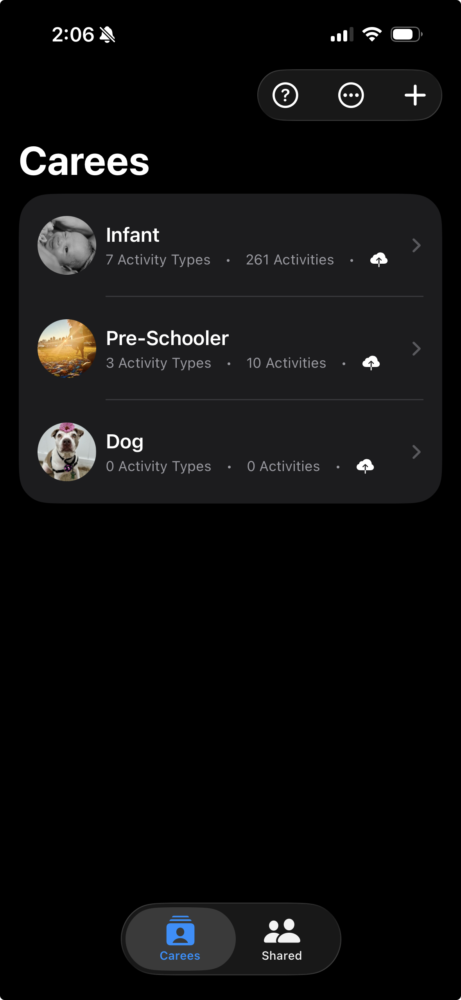
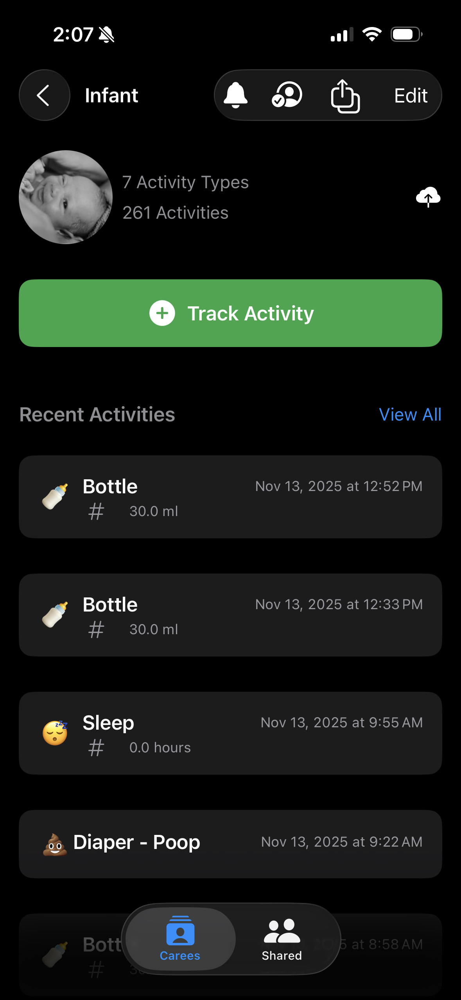
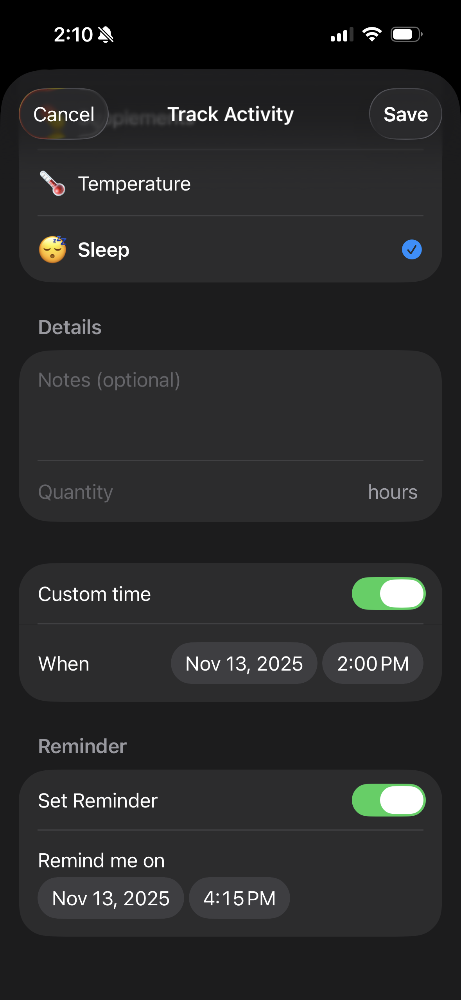
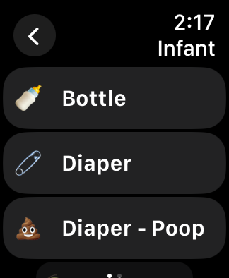

# CareKeeper

**Simple, flexible, and collaborative care tracking for iOS and watchOS**

CareKeeper helps caregivers track care activities for children, pets, or anyone who they support. Track feedings, activities, and more - all synced in real-time across devices.

  
  
  
  

## Features

### Simple: Fast Activity Tracking
Prioritizes speed of data entry. Quick tracking inspired by Apple Workouts. Track an activity in seconds with customizable types, quantities, locations, and notes.

* Once set up, you can **track an activity to take as few as 3 taps**, typically 4-5
  * On iOS: Launch app -> Select caree -> Select activity type -> Save
  * On watchOS: Launch app -> Select caree -> Select activity type -> Save
    * App stays on the "Select activity type" screen, so subsequent entries can be as quick as: Launch app -> Select activity type -> Save
* Available lock/home screen widgets make launch the app as quick as possible.

#### watchOS Companion
Track activities from your wrist and schedule quick reminders with the Digital Crown.

### Flexible
Define your own taxonomy. Create custom activity types with icons, quantity units, and location tracking to match your care needs.

### Collaborative
Share carees with other caregivers via iCloud. All participants can track activities and see real-time updates.

### Privacy-First
* No ads, no third-party trackers
* Your data is encrypted in transit and at rest using Apple's iCloud infrastructure. Only invited caregivers can access shared data.

### Offline Support
Works offline with automatic sync when connected. Track activities anywhere, anytime.

### Data Portability
Export your data to or import it from JSON at any time.

### Personal Reminders
On iPhone, reminders are saved into Apple’s Reminders app (and sync via iCloud). On Apple Watch, CareKeeper schedules local notifications.

## Getting Started

New to CareKeeper? Follow these tutorials to get up and running:

1. [Getting Started](tutorials/getting-started.md) - Install and set up CareKeeper
2. [Creating Your First Caree](tutorials/first-caree.md) - Add your first care recipient
3. [Setting Up a Feeding Tracker](tutorials/feeding-tracker.md) - Create activity types for feeding

## Quick Links

### For New Users
- [How to Track an Activity](how-to/track-activity.md)
- [How to Schedule Reminders](how-to/set-reminders.md)
- [Add a Lock Screen Launcher](how-to/add-lock-screen-widget.md)
- [Understanding Security & Privacy](explanation/security-privacy.md)

### For Collaborative Care
- [How to Share a Caree](how-to/share-caree.md)
- [Understanding Collaboration](explanation/collaboration.md)
- [Using the Watch App](how-to/use-watch-app.md)

### For Advanced Users
- [Export Your Data](how-to/export-data.md)

## Need Help?

- **FAQ**: Browse [frequently asked questions](reference/faq.md)

## About CareKeeper

Have you ever asked yourself (or out loud) things like 

* "How old is this bottle of milk"? 
* "...and what kind of milk was it?" (since they can have variable shelf lives)
* "When was the baby's last poop"?
 
 These are the types of questions we sometimes need to be ask/answer in the wee hours of the morning, when we're low on sleep and have a newborn/infant crying or on the verge thereof.

 If 
 
 * These questions resonate with you
 * You find it unreliable to commit the answers to memory
 * You find it is not always feasible to whip out a phone or paper notes to jot down the answers
 * Are in the Apple device ecosystem
  
...then CareKeeper might be a good fit for you.

---

*Ready to start tracking? [Get started now →](tutorials/getting-started.md)*
