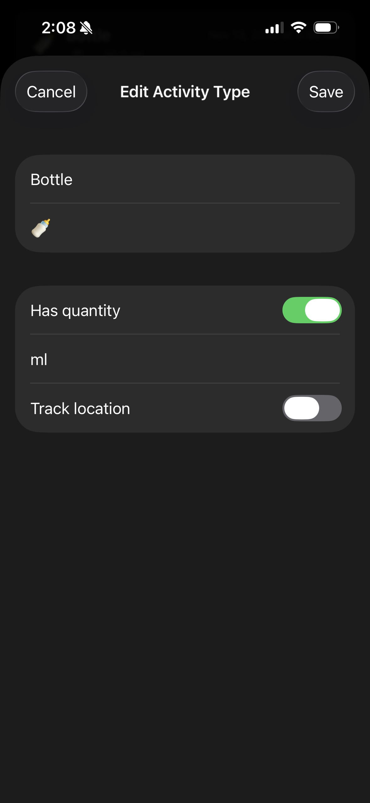
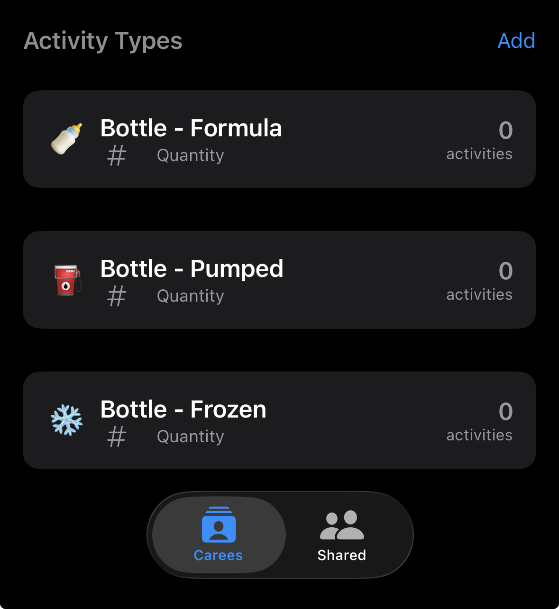
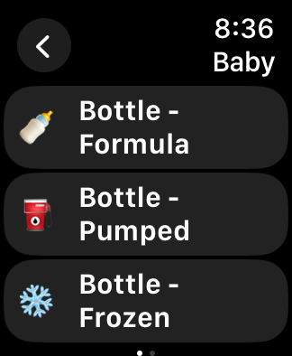
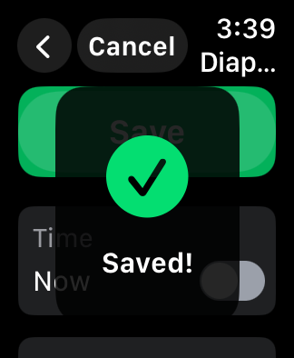
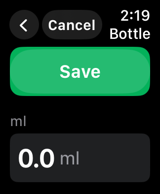
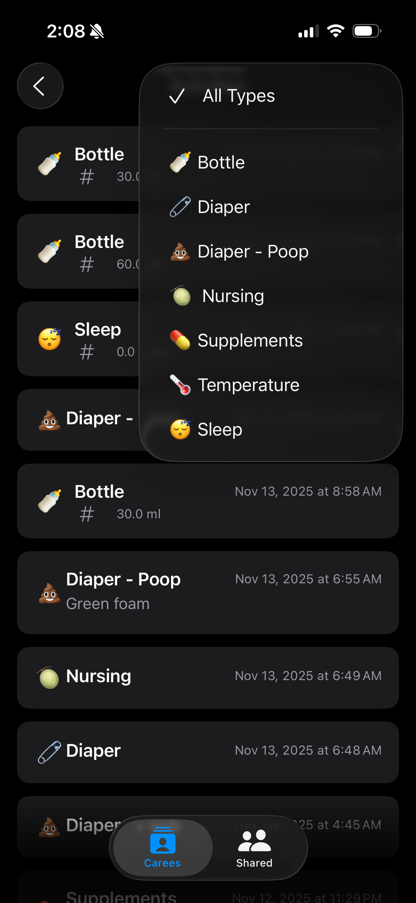

# Setting Up a Feeding Tracker

In this tutorial, you'll learn how to create custom activity types to track feeding for your caree. This is a practical example that demonstrates CareKeeper's flexible tracking system.

## What You'll Learn

- How to create activity types
- How to enable quantity tracking
- How to use quantity units
- How to track your first activity
- How to use the watch app for quick tracking

## Prerequisites

- You have [created a caree](first-caree.md) to track for

## Scenario

You're tracking feeding for a baby. You may want to record things like:
- Bottle feeding with quantity in ounces
- Nursing (left/right side)
- Solid foods

This tutorial will focus on the bottle feeding setup.

## Approach 1: Simple Setup (One Activity Type)

**Best for:** Primary use on iPhone where typing is easy

### Setup

Create a single **"Bottle"** activity type with quantity enabled.

{: .doc-screenshot }

### Logging an Activity

Use the **notes field** to specify the type:
- "Formula"
- "Pumped milk"
- "Donor milk"
  

  
  

### Pros & Cons

Pros:
- Simple, minimal setup
- All feeding in one list
- Quick to set up

Cons:
- Requires typing when using Apple Watch
- Can't quickly see breakdown by type
- Since notes are not a required field, its easy to forget
  - ...but you can always edit to add them later on either the phone or watch

## Approach 2: Granular Setup (Multiple Activity Types)

**Best for:** Apple Watch usage or wanting type-specific analytics

### Setup

Create separate activity types for each feeding type:
- Bottle - Formula (with quantity)
- Bottle - Pumped (with quantity)
- Bottle - Frozen (with quantity)

### Logging an Activity

Just tap the appropriate activity type and enter quantity - no typing needed!

### Pros & Cons

Pros:
- **Works well on Apple Watch** - no typing required
- Easy to see breakdown (5 formula, 3 fresh, 2 frozen today)
- Forces you to specify type (can't forget)
- Can set different default quantities per type
 
Cons:
- More initial setup
- More activity types to scroll through
- Slightly more taps on iPhone
- 

## Hybrid Approach

You can combine both:
- Use granular types for most common actions
- Add a "Bottle - Other" with notes for rare cases

## Track from Apple Watch

The watch app makes tracking even faster:

1. Open CareKeeper on your Apple Watch
2. Tap on your caree
3. Tap Track 
4. You'll see all activity types as large buttons

### Quick Track (No Quantity)

For activity types without quantity:
1. Tap the activity type button (e.g., "Solids")
2. Tap "Save". 
3. You'll see a confirmation checkmark

### Track with Quantity

For activity types with quantity:
1. Tap the activity type button (e.g., "Bottle")
2. Use the **Digital Crown** to adjust the quantity
3. Turn clockwise to increase, counterclockwise to decrease
4. Tap **Save** or press the crown

!!! tip "Digital Crown Tips"
    - Spin faster for larger jumps
    - Spin slowly for precise adjustments
    - The current value is shown prominently

## Viewing Activity History

To see all activities for a caree:

1. Open the caree detail view
2. Scroll to "Recent Activities"
3. Tap **See All Activities** to view complete history

{: .doc-screenshot }

### Activity List Features

- **Filter by type**: Tap the filter button to show only specific activity types
- **Details**: Tap an activity to see and/or edit full details and notes

  
  

## Reordering Activity Types

Put your most-used activity types at the top:

1. Tap **Edit** in the Activity Types section
2. Drag the ☰ handle to reorder
3. Tap **Done**

[SCREENSHOT: Reordering activity types]

!!! tip "Watch App Order"
    The order you set on iPhone is reflected on your watch, so put frequently-used types at the top for quick access.

## What's Next?

Now you know how to:
- ✅ Create custom activity types
- ✅ Configure quantity tracking
- ✅ Track activities on iPhone and watch
- ✅ View activity history

### Learn More

- [Create custom activity types](../how-to/create-activity-type.md) - Learn about location tracking and advanced options
- [Share with other caregivers](../how-to/share-caree.md) - Collaborate with family, partners, or care providers
- [Export your data](../how-to/export-data.md) - Get your tracking data out of CareKeeper

## Troubleshooting

### "Activity Type Not Showing on Watch"
- Open the CareKeeper watch app and wait a few seconds for sync
- Try force-quitting and reopening the watch app
- Check that your watch is connected to your iPhone

---

**Tutorials Complete!** You're now ready to explore CareKeeper on your own. Check out the [How-To Guides](../how-to/track-activity.md) for specific tasks.
