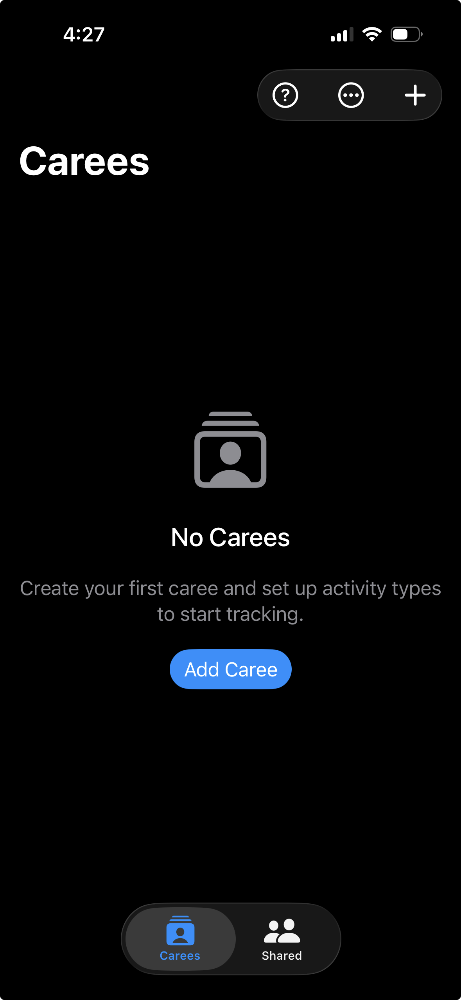
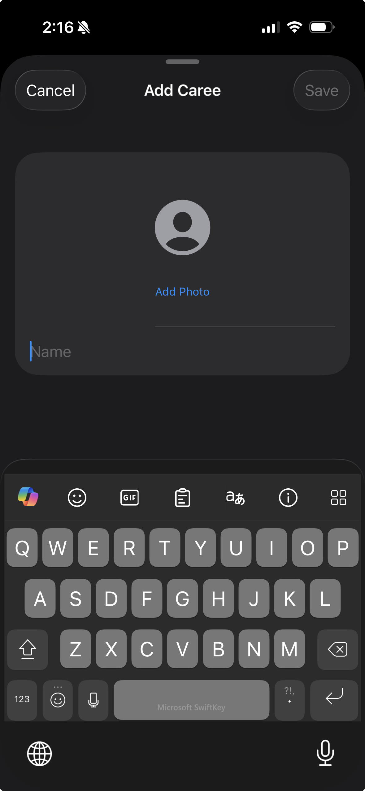
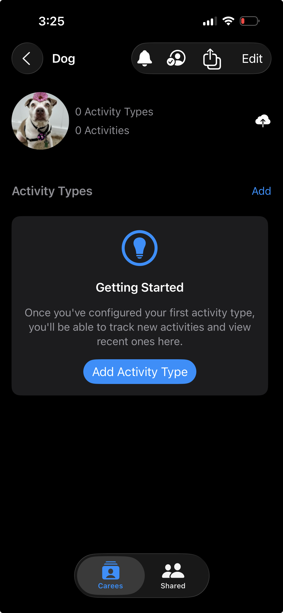
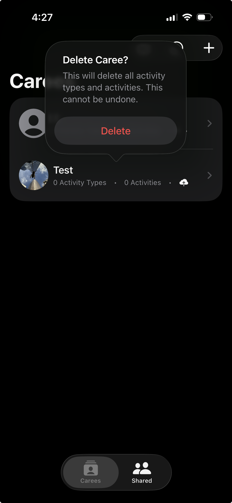
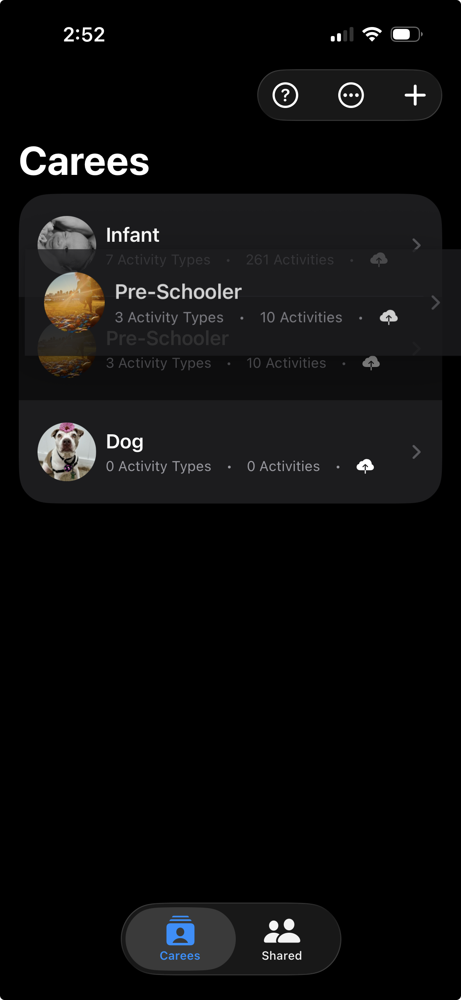

# Creating Your First Caree

In this tutorial, you'll learn how to create your first caree and understand how to organize your care tracking.

## What You'll Learn

- How to create a new caree
- How to add a profile photo
- How to edit caree details
- How to reorder carees

## Prerequisites

- CareKeeper installed and set up (see [Getting Started](getting-started.md))

## Step 1: Open the Carees List

1. Launch CareKeeper on your iPhone
2. You'll see the main Carees tab
3. If this is your first time, the list will be empty with a message like "No carees yet"

{: .doc-screenshot }

## Step 2: Create a New Caree

1. Tap the **+** button in the top-right corner
2. You'll see the "New Caree" form

{: .doc-screenshot }

## Step 3: Fill in Caree Details

### Name (Required)
1. Tap the **Name** field
2. Enter the caree's name (e.g., "Emma", "Max the Dog", "Mom")
3. The name will appear in lists and on the watch app

### Profile Photo (Optional)
1. Tap **Add Photo**
2. Choose from:
   - **Take Photo**: Use your camera
   - **Choose Photo**: Select from your photo library
3. Crop and adjust as desired
4. Tap **Choose** to confirm

!!! note "Photo Privacy"
    Profile photos are synced via iCloud and visible to anyone you share this caree with. Choose appropriate photos if sharing with other caregivers.

## Step 4: Save Your Caree

1. Tap **Save** in the top-right corner
2. Your new caree appears in the list
3. You'll see a success message briefly

!!! success "Syncing"
    Your caree is automatically synced to iCloud and will appear on all your devices within seconds.

## Step 5: View Caree Details

1. Tap on your newly created caree
2. You'll see the caree detail view with:
   - Profile photo (if added)
   - Name
   - Activity Types section (empty for now)
   - Recent Activities (empty for now)

{: .doc-screenshot }

## Managing Carees

### Edit a Caree

1. Open the caree detail view
2. Tap **Edit** in the top-right corner
3. Modify the name or photo
4. Tap **Save**

### Delete a Caree

!!! danger "Permanent Deletion"
    Deleting a caree also deletes all its activity types and activities. This cannot be undone.

1. Open the caree detail view
2. Tap **Edit** in the top-right corner
3. Scroll down and tap **Delete Caree**
4. Confirm the deletion

{: .doc-screenshot }

### Reorder Carees

If you have multiple carees, you can change their order:

1. In the Carees list, tap and hold on a caree until it starts to hover 
2. Drag it to the new desired position
3. Drop to reorder

!!! tip "Reordering lists"
    You can reorder both the Carees and Activity Types lists

!!! tip "Pull-to-refresh lists"
    Most views in the app support pull-to-refresh to fetch latest data and refresh cache

{: .doc-screenshot }

## What's Next?

Now that you have a caree, you're ready to:

1. **Create activity types**: Define what activities you want to track (feeding, diaper changes, sleep, etc.)
2. **Start tracking**: Log your first activity

Continue to the next tutorial: [Setting Up a Feeding Tracker →](feeding-tracker.md)

## Troubleshooting

### Caree Not Appearing on Watch
- Open the CareKeeper watch app (it may need to launch once to sync)
- Wait a few seconds for iCloud sync to complete
- Try pulling down to refresh on the watch

---

**Next**: [Setting Up a Feeding Tracker →](feeding-tracker.md)
