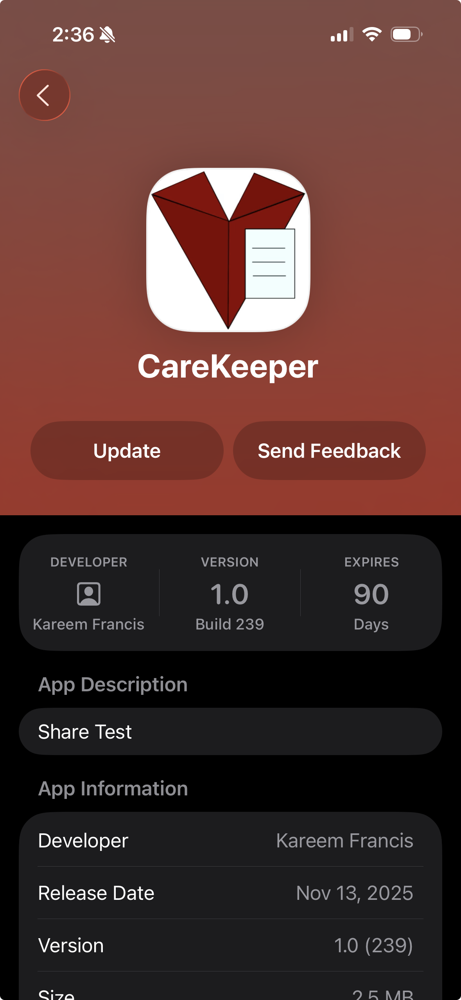
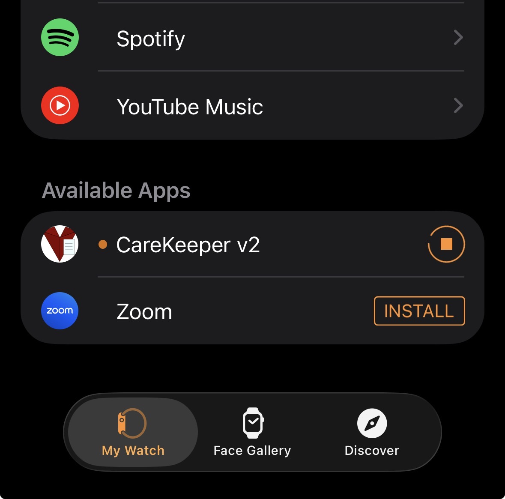
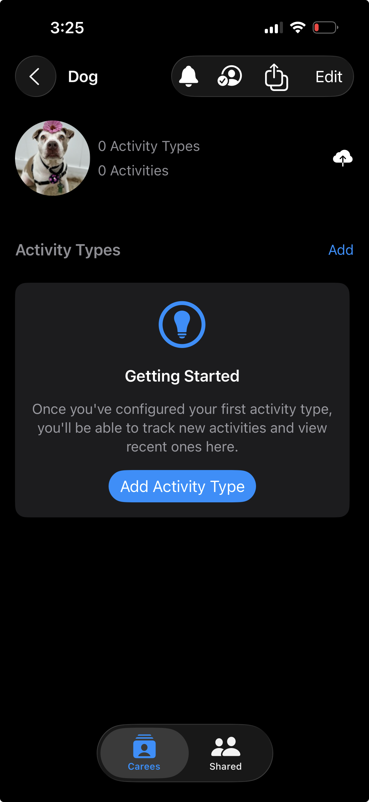

# Getting Started with CareKeeper

Learn the basics of CareKeeper by creating your first caree and logging your first activity.                                                                                                                                                                                                 
## What You'll Learn

By the end of this tutorial, you'll know how to:

- Install CareKeeper on your iPhone and Apple Watch
- Set up your iCloud account for sync
- Navigate the app's main interface
- Understand the core concepts (carees, activity types, activities)

## Prerequisites

- iPhone running iOS 18.0 or later
- Optional but recommended: Apple Watch running watchOS 10.0 or later
- iCloud account signed in

## Step 1: Install CareKeeper

### On iPhone

1. Open the App Store on your iPhone
2. ~~Search for "CareKeeper"~~
3. Search for "Test Flight" 
4. Tap **Get** or the download button
5. Authenticate with your iCloud account
6. Wait for the app to install

{: .doc-screenshot }

### On Apple Watch

CareKeeper automatically installs on your Apple Watch when you install it on your iPhone. If it doesn't:

1. Open the Watch app on your iPhone
2. Scroll down to find CareKeeper
3. Tap **Install**

## Step 2: Launch CareKeeper

1. Tap the CareKeeper icon on your iPhone home screen
2. You'll see a welcome screen
3. Tap **Get Started**

## Step 3: Grant Permissions

CareKeeper may request permissions for:

- **Notifications**: To alert you about shared activities from other caregivers
- **Location**: To track where activities occurred (optional, only if you create activity types with location tracking)

!!! tip "Permissions"
    You can always change these permissions later in Settings > CareKeeper

  
  

## Step 4: Verify iCloud Sync

CareKeeper uses iCloud to sync your data across devices and enable sharing:

!!! warning "iCloud Required"
    CareKeeper requires iCloud to sync data between devices and share with other caregivers. Make sure you're signed into iCloud in Settings > [Your Name] > iCloud.

## Core Concepts

Before creating your first caree, let's understand the key concepts:

### Caree
A **caree** is the person (or pet!) you're tracking care for. Examples:
- Your baby
- Your dog

Each caree can have multiple activity types.

### Activity Type
An **activity type** is a category of activity you want to track. Examples:
- Feeding (with quantity in oz/ml)
- Diaper change
- Bottle feeding (with volume)
- Walk (with location)

Activity types are customizable with:
- Name and icon
- Optional quantity tracking (e.g., "3.5 oz")
- Optional location tracking (e.g., "walked at Central Park")

### Activity
An **activity** is a single instance of tracking. Examples:
- "Fed 4 oz at 2:30 PM"
- "Changed diaper at 3:15 PM"
- "Bottle fed 4oz at 8:00 AM"

## Next Steps

Now that you understand the basics, you're ready to:

1. [Create your first caree →](first-caree.md)
2. [Set up activity tracking →](feeding-tracker.md)

---

**Next**: [Creating Your First Caree →](first-caree.md)
